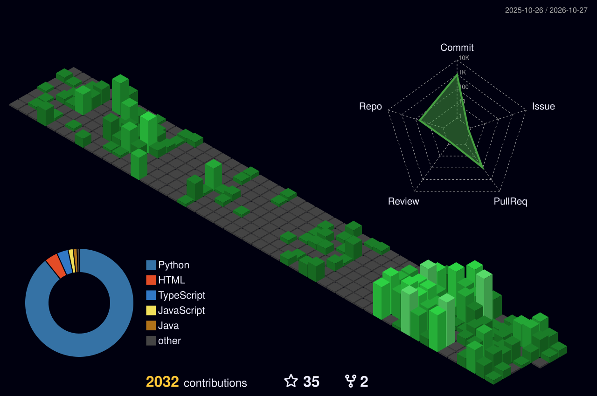

### Hi, I'm Lương Quốc Khánh 👋

**Computer Vision Researcher · Medical Image Analysis · Hanoi University of Science and Technology**

## About Me

I am a Computer Vision researcher at **Hanoi University of Science and Technology (HUST)**, working primarily on **medical image analysis**.

My research interests include **cardiac MRI segmentation**, **physics-guided deep learning**, **efficient vision architectures**, and **2D-to-3D medical image reconstruction**. I am particularly interested in building models that remain reliable under imperfect data and practical deployment constraints.

**Research focus:** `Medical Image Segmentation` · `Cardiac MRI` · `Physics-Informed Learning` · `3D Reconstruction` · `Efficient Vision Models`

## Selected Publication

**Integrating physics guidance into deep learning for cine cardiovascular segmentation**

My Anh Tran-Nguyen, **Quoc Khanh Luong**, Minh Bao Kha, Tuan Linh Dang.  
*Computerized Medical Imaging and Graphics*, **134**, 102798 (2026).

Presents **PGE-UNet**, a lightweight cine-CMR segmentation framework combining a noise-aware encoder, physics-regularized decoder, and simulated RF transmit-field guidance.

[**Read the paper**](https://doi.org/10.1016/j.compmedimag.2026.102798) · [**Source code**](https://github.com/QuocKhanhLuong/PGE-UNet) · [**Model weights**](https://huggingface.co/QuocKhanhLuong/PGE-UNet)

## Featured Research

| Project | Focus |
| :--- | :--- |
| **[PGE-UNet](https://github.com/QuocKhanhLuong/PGE-UNet)** | Published physics-guided, parameter-efficient segmentation for cine cardiac MRI. |
| **[Self-Audit / SpecUMamba](https://github.com/QuocKhanhLuong/Self-Audit)** | Ongoing research into image-only cardiac segmentation, conservative pseudo-labeling, and student refinement without ground-truth supervision during training. |

## Technical Toolkit

**MONAI** · **NumPy** · **Scientific Computing** · **Reproducible ML**

## GitHub at a Glance

## Contribution Heatmap

<!-- Generated daily by .github/workflows/profile-3d.yml -->
<picture>
  <source media="(prefers-color-scheme: dark)" srcset="./profile-3d-contrib/profile-night-green.svg" />
  <source media="(prefers-color-scheme: light)" srcset="./profile-3d-contrib/profile-green.svg" />
  
</picture>

3D contribution calendar · automatically refreshed by GitHub Actions

<b>Recent GitHub activity</b>

## Connect

[**GitHub**](https://github.com/QuocKhanhLuong) · [**LinkedIn**](https://www.linkedin.com/in/qu%E1%BB%91c-kh%C3%A1nh-l%C6%B0%C6%A1ng-05aa2b322/) · [**Facebook**](https://www.facebook.com/alvin.khanh1g) · [**Instagram**](https://www.instagram.com/_alvin.khanhlg_/)

Interested in medical imaging, robust vision models, or research collaboration? Feel free to reach out on LinkedIn.
